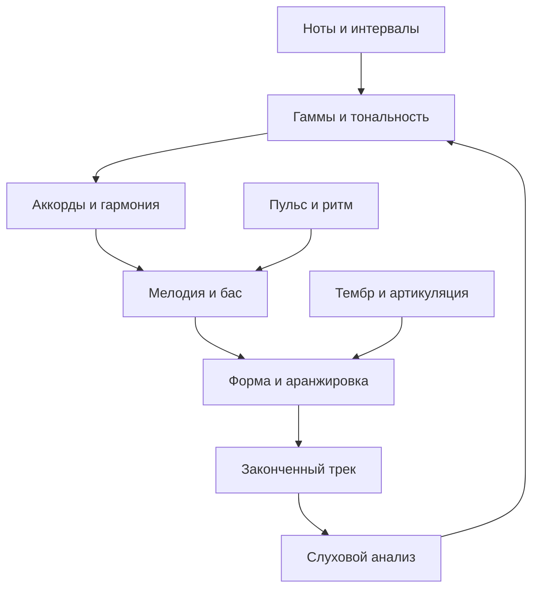

# Главная

База для гитариста, который начинает писать электронную музыку, гиперпоп и рок в Waveform и хочет понимать музыкальную теорию.

**Начни с [[Как пользоваться базой]], затем открой [[Маршрут обучения]].**

Основной теоретический блок содержит **93 коротких понятийных карточек**. Каждая содержит объяснение, пример, действие и вопрос с раскрываемым ответом. Вся база работает без сторонних плагинов Obsidian.

## Карты знаний

- [[Карта — Основы звука и нот]]
- [[Карта — Ритм]]
- [[Карта — Интервалы и тональности]]
- [[Карта — Аккорды и гармония]]
- [[Карта — Мелодия и сочинение]]
- [[Карта — Слух и применение в DAW]]

## Учёба и практика

- [[Маршрут обучения]] — 12 этапов с проверяемыми результатами.
- [[Практикум]] — задания от первой записи до двух готовых треков.
- [[Контрольные вопросы]] — проверка связей между темами.
- [[Словарь RU-EN]] — слова из интерфейса и англоязычных уроков.
- [[Ошибки и важные оговорки]] — где легко неправильно понять теорию.
- [[Источники]] — бесплатные учебные материалы и документация.
- [[Журнал занятий]] — отмечай то, что сделал и услышал.
- [[Шаблон карточки]] и [[Шаблон разбора трека]] — для твоих дополнений.

## Связь дисциплин

Это педагогическая схема, а не утверждение, что музыку обязательно писать в таком порядке. Можно начать с гитарного риффа, ритма, тембра или голоса.

## Студия на NixOS — обновление 28 октября 2026

Начни с [[Карта — Домашняя студия]] и [[Стартовый комплект]]. Новые карточки связывают Waveform, инструменты и обработку с теорией. Установка описана отдельно от творческой практики. Основная система — NixOS; Windows остаётся дополнительной средой.

[[Шаблон проекта Waveform]] · [[Паспорт рабочего окружения]] · [[Изменения базы]]
