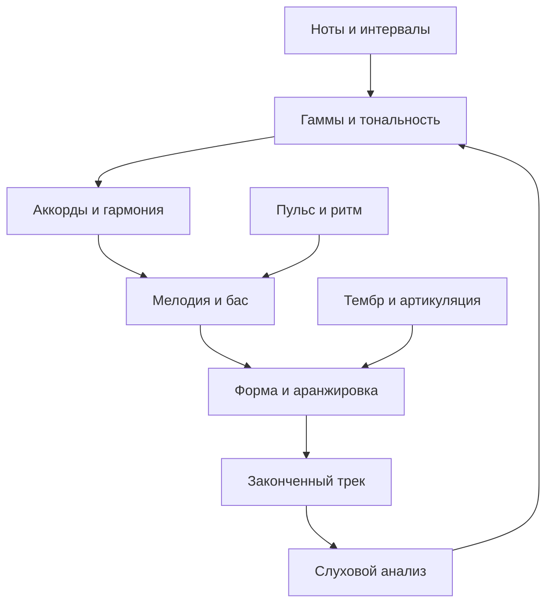

# Главная

База для гитариста, который начинает писать электронную музыку, гиперпоп и рок в Waveform и хочет понимать музыкальную теорию.

**Начни с [Как пользоваться базой](%D0%9A%D0%B0%D0%BA%20%D0%BF%D0%BE%D0%BB%D1%8C%D0%B7%D0%BE%D0%B2%D0%B0%D1%82%D1%8C%D1%81%D1%8F%20%D0%B1%D0%B0%D0%B7%D0%BE%D0%B9.md), затем открой [Маршрут обучения](%D0%9C%D0%B0%D1%80%D1%88%D1%80%D1%83%D1%82%20%D0%BE%D0%B1%D1%83%D1%87%D0%B5%D0%BD%D0%B8%D1%8F.md).**

Основной теоретический блок содержит **93 коротких понятийных карточек**. Каждая содержит объяснение, пример, действие и вопрос с раскрываемым ответом. Вся база работает без сторонних плагинов Obsidian.

## Карты знаний

- [Карта — Основы звука и нот](%D0%9A%D0%B0%D1%80%D1%82%D0%B0%20%E2%80%94%20%D0%9E%D1%81%D0%BD%D0%BE%D0%B2%D1%8B%20%D0%B7%D0%B2%D1%83%D0%BA%D0%B0%20%D0%B8%20%D0%BD%D0%BE%D1%82.md)
- [Карта — Ритм](%D0%9A%D0%B0%D1%80%D1%82%D0%B0%20%E2%80%94%20%D0%A0%D0%B8%D1%82%D0%BC.md)
- [Карта — Интервалы и тональности](%D0%9A%D0%B0%D1%80%D1%82%D0%B0%20%E2%80%94%20%D0%98%D0%BD%D1%82%D0%B5%D1%80%D0%B2%D0%B0%D0%BB%D1%8B%20%D0%B8%20%D1%82%D0%BE%D0%BD%D0%B0%D0%BB%D1%8C%D0%BD%D0%BE%D1%81%D1%82%D0%B8.md)
- [Карта — Аккорды и гармония](%D0%9A%D0%B0%D1%80%D1%82%D0%B0%20%E2%80%94%20%D0%90%D0%BA%D0%BA%D0%BE%D1%80%D0%B4%D1%8B%20%D0%B8%20%D0%B3%D0%B0%D1%80%D0%BC%D0%BE%D0%BD%D0%B8%D1%8F.md)
- [Карта — Мелодия и сочинение](%D0%9A%D0%B0%D1%80%D1%82%D0%B0%20%E2%80%94%20%D0%9C%D0%B5%D0%BB%D0%BE%D0%B4%D0%B8%D1%8F%20%D0%B8%20%D1%81%D0%BE%D1%87%D0%B8%D0%BD%D0%B5%D0%BD%D0%B8%D0%B5.md)
- [Карта — Слух и применение в DAW](%D0%9A%D0%B0%D1%80%D1%82%D0%B0%20%E2%80%94%20%D0%A1%D0%BB%D1%83%D1%85%20%D0%B8%20%D0%BF%D1%80%D0%B8%D0%BC%D0%B5%D0%BD%D0%B5%D0%BD%D0%B8%D0%B5%20%D0%B2%20DAW.md)

## Учёба и практика

- [Маршрут обучения](%D0%9C%D0%B0%D1%80%D1%88%D1%80%D1%83%D1%82%20%D0%BE%D0%B1%D1%83%D1%87%D0%B5%D0%BD%D0%B8%D1%8F.md) — 12 этапов с проверяемыми результатами.
- [Практикум](%D0%9F%D1%80%D0%B0%D0%BA%D1%82%D0%B8%D0%BA%D1%83%D0%BC.md) — задания от первой записи до двух готовых треков.
- [Контрольные вопросы](../08%20%D0%9F%D1%80%D0%BE%D0%B2%D0%B5%D1%80%D0%BA%D0%B0%20%D0%B8%20%D1%81%D0%BF%D1%80%D0%B0%D0%B2%D0%BA%D0%B0/%D0%9A%D0%BE%D0%BD%D1%82%D1%80%D0%BE%D0%BB%D1%8C%D0%BD%D1%8B%D0%B5%20%D0%B2%D0%BE%D0%BF%D1%80%D0%BE%D1%81%D1%8B.md) — проверка связей между темами.
- [Словарь RU-EN](../08%20%D0%9F%D1%80%D0%BE%D0%B2%D0%B5%D1%80%D0%BA%D0%B0%20%D0%B8%20%D1%81%D0%BF%D1%80%D0%B0%D0%B2%D0%BA%D0%B0/%D0%A1%D0%BB%D0%BE%D0%B2%D0%B0%D1%80%D1%8C%20RU-EN.md) — слова из интерфейса и англоязычных уроков.
- [Ошибки и важные оговорки](../08%20%D0%9F%D1%80%D0%BE%D0%B2%D0%B5%D1%80%D0%BA%D0%B0%20%D0%B8%20%D1%81%D0%BF%D1%80%D0%B0%D0%B2%D0%BA%D0%B0/%D0%9E%D1%88%D0%B8%D0%B1%D0%BA%D0%B8%20%D0%B8%20%D0%B2%D0%B0%D0%B6%D0%BD%D1%8B%D0%B5%20%D0%BE%D0%B3%D0%BE%D0%B2%D0%BE%D1%80%D0%BA%D0%B8.md) — где легко неправильно понять теорию.
- [Источники](../08%20%D0%9F%D1%80%D0%BE%D0%B2%D0%B5%D1%80%D0%BA%D0%B0%20%D0%B8%20%D1%81%D0%BF%D1%80%D0%B0%D0%B2%D0%BA%D0%B0/%D0%98%D1%81%D1%82%D0%BE%D1%87%D0%BD%D0%B8%D0%BA%D0%B8.md) — бесплатные учебные материалы и документация.
- [Журнал занятий](../09%20%D0%9C%D0%BE%D0%B8%20%D0%B7%D0%B0%D0%BC%D0%B5%D1%82%D0%BA%D0%B8/%D0%96%D1%83%D1%80%D0%BD%D0%B0%D0%BB%20%D0%B7%D0%B0%D0%BD%D1%8F%D1%82%D0%B8%D0%B9.md) — отмечай то, что сделал и услышал.
- [Шаблон карточки](../10%20%D0%A8%D0%B0%D0%B1%D0%BB%D0%BE%D0%BD%D1%8B/%D0%A8%D0%B0%D0%B1%D0%BB%D0%BE%D0%BD%20%D0%BA%D0%B0%D1%80%D1%82%D0%BE%D1%87%D0%BA%D0%B8.md) и [Шаблон разбора трека](../10%20%D0%A8%D0%B0%D0%B1%D0%BB%D0%BE%D0%BD%D1%8B/%D0%A8%D0%B0%D0%B1%D0%BB%D0%BE%D0%BD%20%D1%80%D0%B0%D0%B7%D0%B1%D0%BE%D1%80%D0%B0%20%D1%82%D1%80%D0%B5%D0%BA%D0%B0.md) — для твоих дополнений.

## Связь дисциплин

Это педагогическая схема, а не утверждение, что музыку обязательно писать в таком порядке. Можно начать с гитарного риффа, ритма, тембра или голоса.

## Студия на NixOS — обновление 28 октября 2026

Начни с [Карта — Домашняя студия](%D0%9A%D0%B0%D1%80%D1%82%D0%B0%20%E2%80%94%20%D0%94%D0%BE%D0%BC%D0%B0%D1%88%D0%BD%D1%8F%D1%8F%20%D1%81%D1%82%D1%83%D0%B4%D0%B8%D1%8F.md) и [Стартовый комплект](../13%20%D0%A0%D0%B0%D0%B1%D0%BE%D1%82%D0%B0%20%D0%BD%D0%B0%D0%B4%20%D1%82%D1%80%D0%B5%D0%BA%D0%BE%D0%BC/%D0%A1%D1%82%D0%B0%D1%80%D1%82%D0%BE%D0%B2%D1%8B%D0%B9%20%D0%BA%D0%BE%D0%BC%D0%BF%D0%BB%D0%B5%D0%BA%D1%82.md). Новые карточки связывают Waveform, инструменты и обработку с теорией. Установка описана отдельно от творческой практики. Основная система — NixOS; Windows остаётся дополнительной средой.

[Шаблон проекта Waveform](../13%20%D0%A0%D0%B0%D0%B1%D0%BE%D1%82%D0%B0%20%D0%BD%D0%B0%D0%B4%20%D1%82%D1%80%D0%B5%D0%BA%D0%BE%D0%BC/%D0%A8%D0%B0%D0%B1%D0%BB%D0%BE%D0%BD%20%D0%BF%D1%80%D0%BE%D0%B5%D0%BA%D1%82%D0%B0%20Waveform.md) · [Паспорт рабочего окружения](../09%20%D0%9C%D0%BE%D0%B8%20%D0%B7%D0%B0%D0%BC%D0%B5%D1%82%D0%BA%D0%B8/%D0%9F%D0%B0%D1%81%D0%BF%D0%BE%D1%80%D1%82%20%D1%80%D0%B0%D0%B1%D0%BE%D1%87%D0%B5%D0%B3%D0%BE%20%D0%BE%D0%BA%D1%80%D1%83%D0%B6%D0%B5%D0%BD%D0%B8%D1%8F.md) · [Изменения базы](../08%20%D0%9F%D1%80%D0%BE%D0%B2%D0%B5%D1%80%D0%BA%D0%B0%20%D0%B8%20%D1%81%D0%BF%D1%80%D0%B0%D0%B2%D0%BA%D0%B0/%D0%98%D0%B7%D0%BC%D0%B5%D0%BD%D0%B5%D0%BD%D0%B8%D1%8F%20%D0%B1%D0%B0%D0%B7%D1%8B.md)
